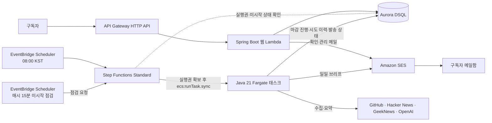

# Daily Brief AWS 전환 설계

AWS 서울 리전(`ap-northeast-2`)의 1차 구성을 Terraform으로 관리할 계획이다. 현재 실행 가능한 MVP는 [README](../../README.md)의 Java, Spring Batch, PostgreSQL, Resend 구성이다. 아래는 엔지니어링 리뷰에서 합의한 AWS 설계와 남은 결정이다.

## 확정한 결정

| 결정 | 합의 내용 |
| --- | --- |
| 웹과 일일 배치 | Java 21의 Spring Boot 웹 Lambda와 Fargate 배치를 별도 이미지로 빌드하고 검증한다. 배치는 웹 서버 없이 마감 ID를 받아 수집·요약·발송을 실행하고 결과에 맞는 종료 코드를 반환한다. |
| SES 수락 이벤트 처리기 | 웹 애플리케이션을 띄우지 않는 Java 21 Lambda 핸들러가 `Email Sent` 이벤트의 `delivery_id`와 SES 메시지 ID로 기존 발송 행에 수락을 기록한다. 같은 이벤트를 다시 받아도 상태는 한 번만 바뀐다. |
| 예약 실행과 복구 | 정규 실행은 매일 08:00 KST다. Step Functions Standard가 Fargate 종료를 추적한다. 이전 태스크의 실제 종료를 확인하고 다음 08:00 전까지 같은 마감의 저장된 진행 지점부터 자동으로 이어간다. |
| 실행권과 이력 | DSQL은 마감별 실행권과 마지막 완료 단계를 한 행에 두고, 별도 테이블에 태스크 시도와 종료 결과를 남긴다. 조건부 쓰기가 커밋된 태스크만 진행한다. |
| 재실행 한도 | 최초 1회와 자동 재실행 최대 2회를 합쳐 마감당 3회다. DSQL 이력을 기준으로 세며, 횟수 또는 기한에 도달하면 운영자에게 알린다. |
| 미시작 마감 | 08:15 KST부터 다음 날 07:15까지 매시 15분에 최근 활성화된 마감을 점검한다. 미시작이 확인될 때만 같은 마감 ID로 실행한다. DB 조회 오류는 미시작으로 처리하지 않는다. |
| SES 응답 유실 | 수락 여부가 불명확한 발송은 자동으로 재제출하지 않고 릴리스 배정을 유지한다. SES가 수락하지 않았다고 명확히 응답한 일시 오류는 제한 내에서 다시 시도할 수 있다. 예약 발송을 켜기 전에 실제 SES 수락 증거를 새 제출 없이 원래 발송 ID에 연결하는 검증이 필요하다. |

## 언어 선택과 코드 재사용

일일 배치의 주요 작업은 외부 API 호출과 DB 상태 갱신이다. Java 21을 사용해 기존 [수집·요약 로직](../../src/main/java/com/dailybrief/collection/CollectionService.java), [발송 로직](../../src/main/java/com/dailybrief/delivery/DeliveryService.java), 수집·발송 회귀 테스트를 재사용한다. GitHub 수집 기준, 발송 직전 구독 상태 확인, 소유 번호를 통한 이전 작업의 상태 덮어쓰기 방지를 유지한다. SES 어댑터와 DSQL에 맞춘 저장소 로직은 별도로 검증한다.

SES 이벤트 처리기는 [기존 운영 명령](../../src/main/java/com/dailybrief/operations/SendReconciliation.java)이 사용하는 수락 상태 전이 규칙을 공유한다. 수락 이벤트가 확인되지 않은 발송은 보류하고 운영자에게 알린다. 대표 배치에서 태스크 시작 시간, 전체 처리 시간, 최대 메모리를 측정한다. 운영 목표를 충족하지 못하고 런타임 비용이 원인으로 확인되면 해당 작업의 언어를 다시 비교한다.

## DSQL 전환 검증

- 기존 PostgreSQL 마이그레이션의 외래 키, ID 생성과 `SELECT … FOR UPDATE` 사용을 점검하고 DSQL에서 같은 무결성과 동시성 보장을 얻는 방법을 검증한다.
- 마감별 실행권 경쟁, 구독 설정 변경과 발송 준비 경합, 이전 소유자의 늦은 완료 기록, 배치와 이벤트 처리기의 동시 수락 기록, 동일 이벤트 중복 처리를 실제 DSQL에서 검증한다.
- DSQL 동시성 충돌 시 DB 트랜잭션만 재시도한다. SES 호출은 재시도 대상 트랜잭션 밖에서 수행한다.

## 검토 중인 항목

- D8에서 SES 수락 이벤트를 `EventBridge → SQS → Java Lambda`로 처리할지, `EventBridge → Java Lambda`로 전달할지 결정한다. 두 방식 모두 수락 상태만 기록하며 메일을 다시 발송하지 않는다.
- 웹 Lambda가 실행 환경을 바꿔도 구독 관리 세션을 유지하고 실제 요청 IP를 신뢰할 수 있는 경로를 확정한다.
- Fargate 재실행 간격, 실행 시간 제한과 태스크 시도 이력 보존 기한을 정한다.

[초기 AWS 구성도](../../diagrams/daily-brief-aws.mmd)는 엔지니어링 리뷰 이전의 안이다. 수집·요약·발송을 Step Functions, Lambda, SQS로 나누는 제안은 후속 전환으로 남겨둔다.
