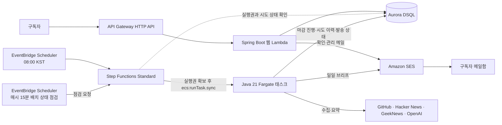

# Daily Brief AWS 전환 설계

AWS 서울 리전(`ap-northeast-2`)의 1차 구성을 Terraform으로 관리할 계획이다. 현재 실행 가능한 MVP는 [README](../../README.md)의 Java, Spring Batch, PostgreSQL, Resend 구성이다. 아래는 엔지니어링 리뷰에서 합의한 AWS 설계와 남은 결정이다.



## 확정한 결정

| 결정 | 합의 내용 |
| --- | --- |
| 웹과 일일 배치 | Java 21의 Spring Boot 웹 Lambda와 Fargate 배치를 별도 이미지로 빌드하고 검증한다. 배치는 웹 서버 없이 마감 ID를 받아 수집·요약·발송을 실행하고 결과에 맞는 종료 코드를 반환한다. |
| SES 수락 이벤트 처리기 | 웹 애플리케이션을 띄우지 않는 Java 21 Lambda 핸들러가 `Email Sent` 이벤트의 `delivery_id`와 SES 메시지 ID로 기존 발송 행에 수락을 기록한다. 같은 이벤트를 다시 받아도 상태는 한 번만 바뀐다. |
| 예약 실행과 복구 | 정규 실행은 매일 08:00 KST다. Step Functions Standard가 Fargate 종료를 추적한다. 이전 태스크의 실제 종료를 확인하고 다음 08:00 전까지 같은 마감의 저장된 진행 지점부터 자동으로 이어간다. |
| 실행권과 이력 | DSQL은 마감별 실행권과 마지막 완료 단계를 한 행에 두고, 별도 테이블에 태스크 시도와 종료 결과를 남긴다. 조건부 쓰기가 커밋된 태스크만 진행한다. |
| 재실행 한도 | 최초 1회와 자동 재실행 최대 2회를 합쳐 마감당 3회다. DSQL 이력을 기준으로 세며, 횟수 또는 기한에 도달하면 운영자에게 알린다. |
| Fargate 재실행과 이력 보존 | 이전 태스크의 `STOPPED` 확인 후 첫 재실행은 5분, 두 번째는 15분 대기한다. 최초 제출 후 45분과 다음 08:00 KST 중 이른 시각에 중지를 요청한다. 종료 결과가 확정된 시도 이력은 종료 시각부터 30일 보존한다. 예약 발송을 켜기 전에 실제 배치에서 검증한다. [Fargate 정책 및 통합 검증](aws-fargate-recovery.md#예약-발송-전-통합-검증) |
| 배치 상태 점검 | 08:15 KST부터 다음 날 07:15까지 매시 15분에 최근 활성화된 마감의 미시작 여부와 미종결 시도를 확인한다. 미시작이 확인되면 같은 마감 ID로 실행한다. 기존 워크플로가 중단된 시도는 조건부 갱신으로 인수하고 ECS 상태를 확인한다. DB 조회 오류는 미시작으로 처리하지 않는다. [Fargate 복구 규칙](aws-fargate-recovery.md) |
| SES 응답 유실 | 수락 여부가 불명확한 발송은 자동으로 재제출하지 않고 릴리스 배정을 유지한다. SES가 수락하지 않았다고 명확히 응답한 일시 오류는 제한 내에서 다시 시도할 수 있다. 예약 발송을 켜기 전에 실제 SES 수락 증거를 새 제출 없이 원래 발송 ID에 연결하는 검증이 필요하다. |

## 언어 선택과 코드 재사용

일일 배치의 주요 작업은 외부 API 호출과 DB 상태 갱신이다. Java 21을 사용해 기존 [수집·요약 로직](../../src/main/java/com/dailybrief/collection/CollectionService.java), [발송 로직](../../src/main/java/com/dailybrief/delivery/DeliveryService.java), 수집·발송 회귀 테스트를 재사용한다. GitHub 수집 기준, 발송 직전 구독 상태 확인, 소유 번호를 통한 이전 작업의 상태 덮어쓰기 방지를 유지한다. SES 어댑터와 DSQL에 맞춘 저장소 로직은 별도로 검증한다.

SES 이벤트 처리기는 [기존 운영 명령](../../src/main/java/com/dailybrief/operations/SendReconciliation.java)이 사용하는 수락 상태 전이 규칙을 공유한다. 수락 이벤트가 확인되지 않은 발송은 보류하고 운영자에게 알린다. 대표 배치에서 태스크 시작 시간, 전체 처리 시간, 최대 메모리를 측정한다. 운영 목표를 충족하지 못하고 런타임 비용이 원인으로 확인되면 해당 작업의 언어를 다시 비교한다.

## DSQL 전환 검증

- V2의 구독자 ID는 기존 `BIGINT GENERATED BY DEFAULT AS IDENTITY` 선언으로 생성하면 DSQL에서 `0A000`이 발생한다. 검증 스키마는 `CACHE 65536`을 명시한다. V2~V4의 외래 키 선언은 유지한다. [DSQL CREATE TABLE](https://docs.aws.amazon.com/aurora-dsql/latest/userguide/create-table-syntax-support.html)
- V1은 Spring Batch의 PostgreSQL 스키마를 한 번에 적용하고, V2~V4도 파일마다 여러 DDL 문을 포함한다. DSQL은 트랜잭션당 DDL 한 문장만 허용하므로 별도 마이그레이션 경로가 필요하다. [DSQL 초기화 명령](../../README.md#aurora-dsql-스키마-초기화)은 V2~V4를 문장별로 적용하고 V3·V4의 보조 인덱스를 `CREATE INDEX ASYNC`로 생성한 뒤 `CALL sys.wait_for_job(...)`으로 완료를 확인한다. [DDL 트랜잭션](https://docs.aws.amazon.com/aurora-dsql/latest/userguide/working-with-ddl.html) · [비동기 인덱스](https://docs.aws.amazon.com/aurora-dsql/latest/userguide/working-with-create-index-async.html)
- 구독 조회·요청 제한·토큰 소비와 발송 준비·실행권·수락 대조에서 사용하는 `SELECT … FOR UPDATE`는 DSQL에서 커밋 시 충돌을 검사한다. `40001`이면 커밋을 포함한 DB 트랜잭션 전체를 재시도한다. 실행권을 얻은 트랜잭션의 커밋을 확인한 뒤 후속 작업을 수행한다. SES 호출은 DB 재시도 범위 밖에 둔다. [DSQL 동시성 제어](https://docs.aws.amazon.com/aurora-dsql/latest/userguide/working-with-concurrency-control.html)

[DSQL 검증 스크립트](../../scripts/check-dsql-compatibility.py)는 임시 클러스터에서 초기화 명령과 동일한 로직으로 새 스키마를 만들고, 가상 데이터를 넣은 뒤 독립된 두 `psql` 세션으로 SQL을 검증한다. AWS CLI에 DSQL 관리자 연결 권한이 필요하다. 아래 명령은 시스템 인증서 저장소를 사용하는 libpq 17 이상을 기준으로 한다. 이전 libpq에서는 `--ca`로 신뢰할 루트 인증서 파일을 지정한다.

```bash
python3 -B scripts/check-dsql-compatibility.py "$DSQL_TEST_CLUSTER"
```

서울 리전의 임시 DSQL 클러스터에서 다음 결과를 확인했다.

| 시나리오 | 결과 |
| --- | --- |
| V2~V4 테이블 및 인덱스 | 캐시 크기를 명시한 ID가 자동 생성됐다. 존재하지 않는 구독자를 참조하는 행은 `23503`으로 거절됐고, 비동기 인덱스 두 개가 완료됐다. |
| 스키마 초기화 재실행 | 첫 인덱스 제출 직후 세션을 종료하고 새 연결에서 다시 실행했다. 두 인덱스가 유효해졌고, 이후 한 번 더 적용해도 기존 구독자 행과 자동 생성된 ID가 유지됐다. |
| 동일 마감의 실행권 경쟁 | 두 세션에서 조건부 갱신이 각각 한 행을 반환했다. 먼저 커밋한 세션의 실행권만 저장됐고, 다른 세션은 `40001 (OC000)`을 받았다. 새 트랜잭션에서 재시도하니 갱신된 행이 없었다. |
| 중복 SES 수락을 모사한 SQL | 두 세션이 `FOR UPDATE`로 같은 `UNKNOWN` 행을 읽었다. 먼저 커밋한 세션만 `SENT`와 테스트 메시지 ID를 저장했다. 다른 세션은 `40001 (OC000)`을 받았고, 재시도와 이전 소유자의 지연 완료 모두 갱신된 행이 없었다. |

Spring Batch 메타데이터 V1 적용, 구독 설정 변경과 발송 준비 경합, 배치와 이벤트 처리기의 동시 수락 및 실제 SES 이벤트 전달은 후속 통합 검증에 포함한다.

## 검토 중인 항목

- D8의 SES 수락 이벤트 전달 경로로 `EventBridge → SQS Standard → Java 21 Lambda`를 제안했다. Lambda는 원래 발송 행에 수락만 기록한다. 서울 리전에서 실제 `Email Sent` 이벤트가 메일을 다시 제출하지 않고 원래 발송 ID에 연결되는지 확인한다. 이벤트가 도착하지 않았을 때의 발송 보류와 운영자 알림, 두 DLQ 경로와 재처리도 예약 발송을 켜기 전에 검증한다. [D8 제안 및 승인 전 검증](aws-ses-acceptance.md)
- 웹 Lambda가 실행 환경을 바꿔도 구독 관리 세션을 유지하고 실제 요청 IP를 신뢰할 수 있는 경로를 확정한다.

[초기 AWS 구성도](../../diagrams/daily-brief-aws.mmd)는 엔지니어링 리뷰 이전의 안이다. 수집·요약·발송을 Step Functions, Lambda, SQS로 나누는 제안은 후속 전환으로 남겨둔다.
