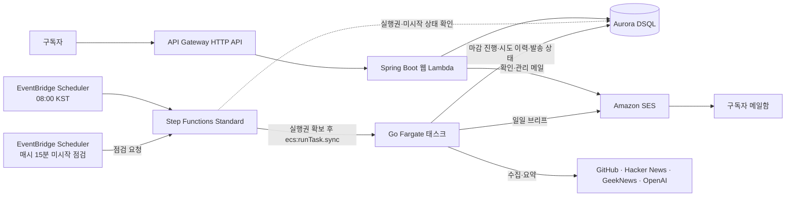

# Daily Brief AWS 전환 설계

AWS 서울 리전(`ap-northeast-2`)의 1차 구성을 Terraform으로 관리할 계획이다. 현재 실행 가능한 MVP는 [README](../../README.md)의 Java, Spring Batch, PostgreSQL, Resend 구성이다. 아래는 엔지니어링 리뷰에서 합의한 AWS 설계와 남은 결정이다.

## 확정한 결정

| 결정 | 합의 내용 |
| --- | --- |
| 배포 이미지 | Spring Boot 웹 Lambda와 Go Fargate 배치를 별도 이미지로 빌드하고 검증한다. Go 배치는 수집·요약·발송을 실행하고 종료한다. |
| 예약 실행과 복구 | 정규 실행은 매일 08:00 KST다. Step Functions Standard가 Fargate 종료를 추적한다. 이전 태스크의 실제 종료를 확인하고 다음 08:00 전까지 같은 마감의 저장된 진행 지점부터 자동으로 이어간다. |
| 실행권과 이력 | DSQL은 마감별 실행권과 마지막 완료 단계를 한 행에 두고, 별도 테이블에 태스크 시도와 종료 결과를 남긴다. 조건부 쓰기가 커밋된 태스크만 진행한다. |
| 재실행 한도 | 최초 1회와 자동 재실행 최대 2회를 합쳐 마감당 3회다. DSQL 이력을 기준으로 세며, 횟수 또는 기한에 도달하면 운영자에게 알린다. |
| 미시작 마감 | 08:15 KST부터 다음 날 07:15까지 매시 15분에 최근 활성화된 마감을 점검한다. 미시작이 확인될 때만 같은 마감 ID로 실행한다. DB 조회 오류는 미시작으로 처리하지 않는다. |
| SES 응답 유실 | 수락 여부가 불명확한 발송은 자동으로 재제출하지 않고 릴리스 배정을 유지한다. SES가 수락하지 않았다고 명확히 응답한 일시 오류는 제한 내에서 다시 시도할 수 있다. 예약 발송을 켜기 전에 실제 SES 수락 증거를 새 제출 없이 원래 발송 ID에 연결하는 검증이 필요하다. |

기존 MVP가 보장하는 GitHub 수집 기준, 발송 직전 구독 상태 확인, 소유 번호를 통한 이전 작업의 상태 덮어쓰기 방지를 Go 배치에서도 유지한다. DSQL 동시성 충돌 시 재시도 범위는 DB 트랜잭션이며 SES 호출은 그 밖에 둔다.

## 검토 중인 항목

- D8에서 SES 수락 이벤트를 `EventBridge → SQS → Go Lambda`로 처리할지, `EventBridge → Go Lambda`로 전달할지 결정한다. 두 방식 모두 수락 상태만 기록하며 메일을 다시 발송하지 않는다.
- DSQL 전용 스키마 마이그레이션과 Java·Go 동시 쓰기 검증을 설계한다.
- 웹 Lambda가 실행 환경을 바꿔도 구독 관리 세션을 유지하고 실제 요청 IP를 신뢰할 수 있는 경로를 확정한다.
- Fargate 재실행 간격, 실행 시간 제한과 태스크 시도 이력 보존 기한을 정한다.

[초기 AWS 구성도](../../diagrams/daily-brief-aws.mmd)는 엔지니어링 리뷰 이전의 안이다. 수집·요약·발송을 Step Functions, Lambda, SQS로 나누는 제안은 후속 전환으로 남겨둔다.
